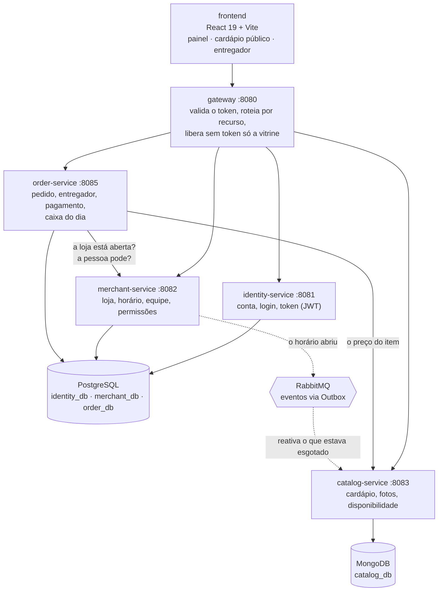

# Containers (C4 nível 2)

Os pedaços que sobem e como se falam. **Desenhado em 09/11/2026**, a partir do
`docker-compose.yml` com os perfis `marco2` e `pedidos`, que é o que roda na entrega de 15/11.
Até aqui, este arquivo apontava para a figura 2 do documento de arquitetura de agosto, em PDF,
retirado do repositório (continua no histórico do Git).

**Regras que o desenho mostra:** o front só fala com o gateway; nenhum serviço lê o banco de
outro (ADR-002), cada um tem o seu banco lógico; quem publica evento usa Outbox (ADR-043); todos
os serviços validam o token pela chave pública do `identity` (ADR-015).

## O que está no Compose e não aparece acima

São peças **planejadas**, que não sobem nos perfis `marco2` e `pedidos`:

| Peça | Para quê, quando chegar a vez |
| --- | --- |
| `settlement-service` (8084) | jornada e custódia do entregador. Hoje o caixa do dia mora no `order` |
| `delivery-service` (8087) | rodízio, posição do entregador e o mapa da entrega (marco 11) |
| `conversation-service` (8088) | o pedido nascendo na conversa do WhatsApp e o atendimento com IA (marcos 7 e 9) |
| Redis | cache do cardápio público, com o primeiro leitor em cache (marco 7 — `catalog-service/build.gradle.kts`) |
| MinIO | guardar as fotos fora do banco, quando o volume pedir; hoje a foto fica numa coleção própria do MongoDB |

Todos sobem com `--profile full`, mas sem uso: os três serviços são esqueletos.
