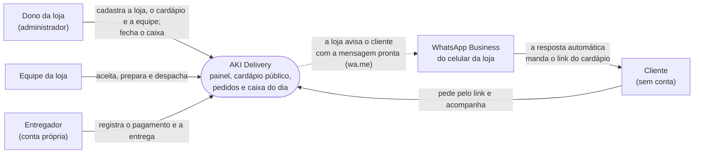

# Contexto (C4 nível 1)

Quem usa o AKI Delivery e com o que ele conversa. **Desenhado em 09/11/2026**, a partir do que
roda na entrega de 15/11 (ADR-077). Até aqui, este arquivo apontava para a figura 1 do documento
de arquitetura de agosto, em PDF, que descrevia o pagamento online e foi retirado do repositório
(continua no histórico do Git).

**O que não está no desenho, de propósito:**

- **Nenhum provedor de pagamento.** O pagamento é presencial (dinheiro, cartão na maquininha da
  loja ou Pix na conta da loja) e fica registrado no pedido (ADR-023).
- **Nenhum envio de SMS.** O código de verificação aparece na tela, só no teste
  (ADR-042, emenda de 01/11/2026).
- **A integração com a API oficial do WhatsApp** é futura: o aviso automático e o pedido nascendo
  na conversa (ADR-075) — os próximos passos do README.
